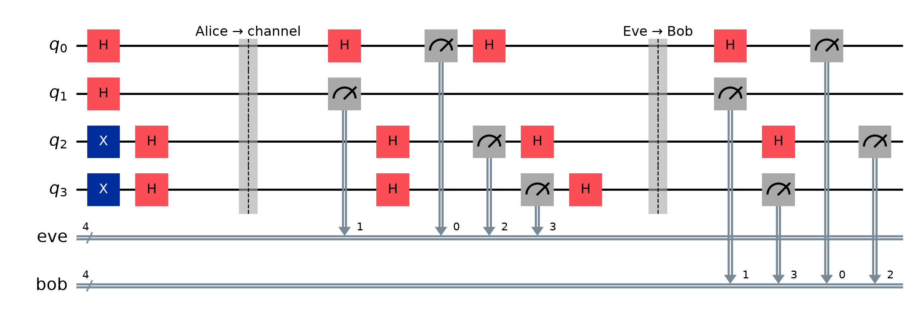
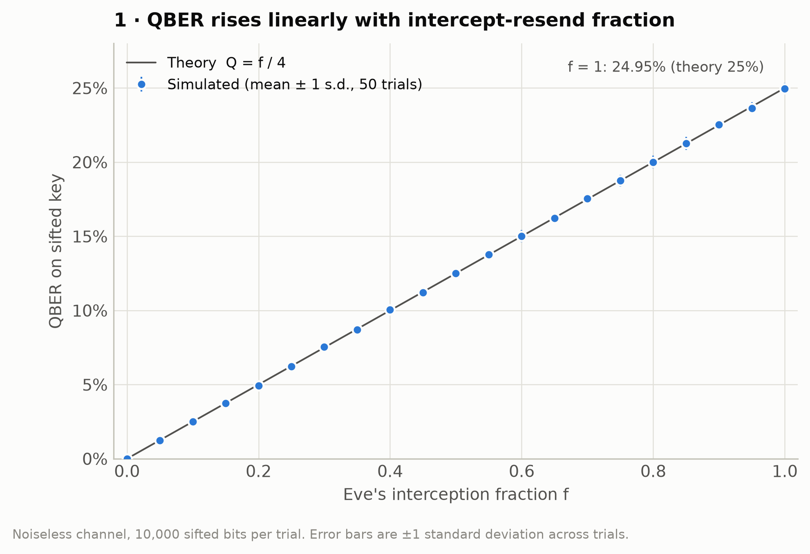
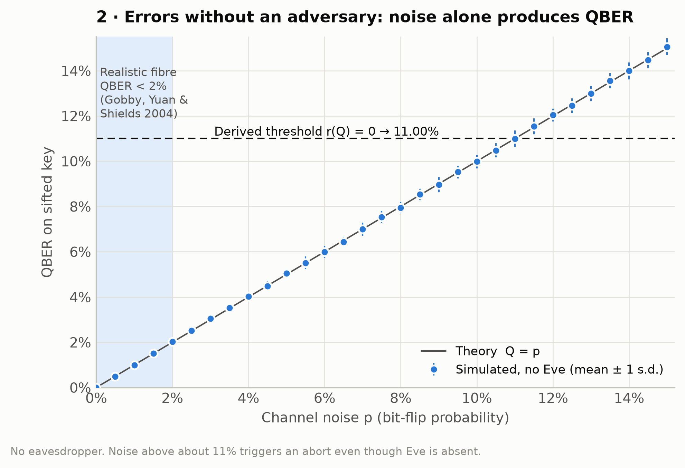
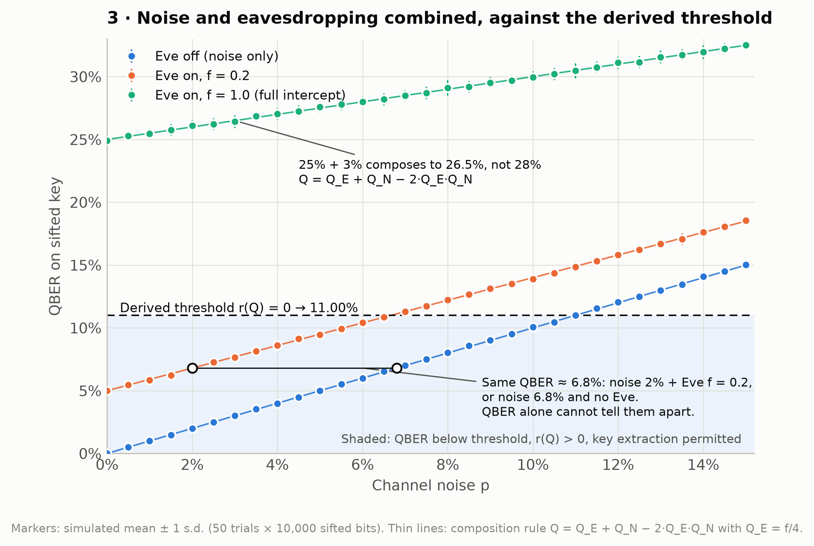
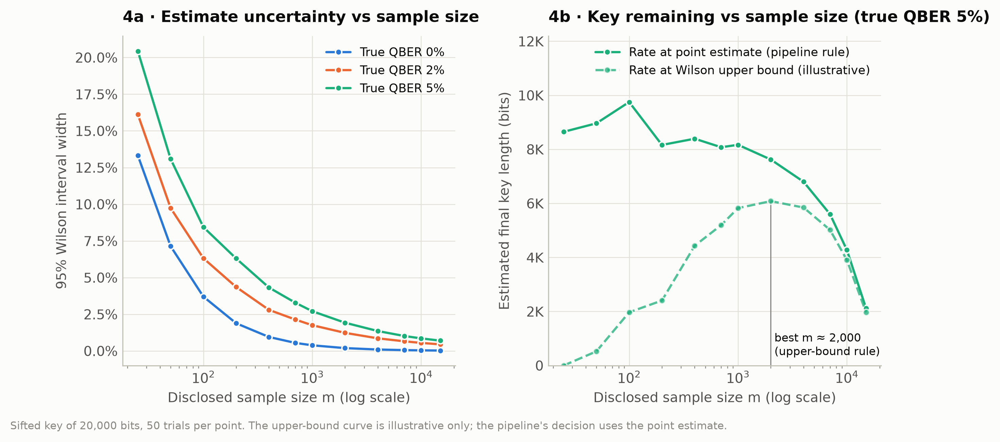
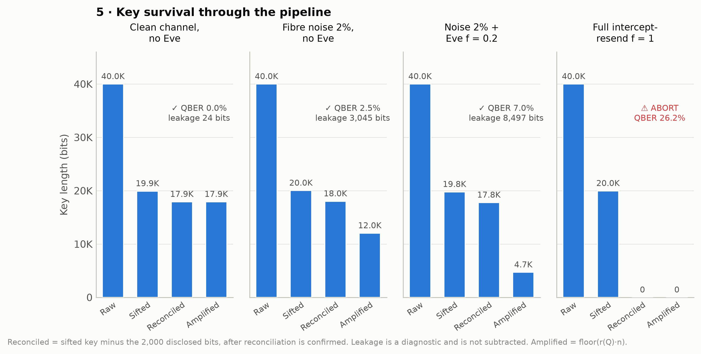
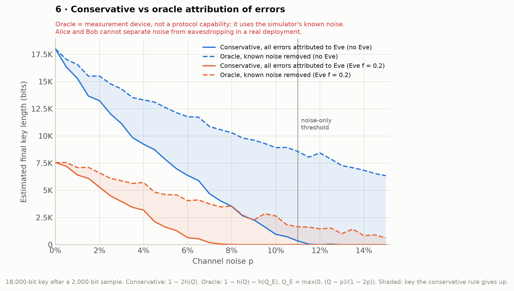

# A Security and Noise Analysis Framework for BB84 Quantum Key Distribution

**AQVH911 · Amaravati Quantum Valley Hackathon 2025** · Theme: QKD Demonstration Simulator · Category: Hardware/Software

> *Problem statement:* Develop a basic simulator for Quantum Key Distribution (BB84 Protocol) to show how secure communication can be achieved using quantum principles.

This project simulates BB84 from qubit preparation to an estimated final key length. It covers realistic channel noise, channel loss and a fractional intercept-resend eavesdropper. It applies a security decision derived from the key-rate equation, then runs error reconciliation and privacy amplification and reports the key that remains.

Every component comes from the published literature (see [References](#references)). The contribution is a complete, reproducible, end-to-end pipeline at student scale. It closes an implementation gap, not a research gap.

**Model specification pages.** Two standalone HTML pages describe the same model, written from the same code, for two audiences. Both are live deliverables, not an old and a new version:

| Page | For | Style |
|---|---|---|
| [`model-review.html`](model-review.html) | The methodology review submission (reviewers reading the specification) | IBM Plex, single reading column |
| [`model.html`](model.html) | The hackathon demo table (visitors at the stand) | Ledgerline-style, with a hero panel of 400 qubits from one real run |

When the model or any reported number changes, update both pages.

---

## 1. Secure communication achieved: the success case

Clean channel, no eavesdropper, 40,000 qubits (`python -m bb84`, seed 42):

```
Sifted key length:             19925 bits
Estimated QBER:                0.0%  (95% CI 0.0–0.2%, sample n=2000)
Security threshold (derived):  11.00%
Status:                        ✓ Key extraction permitted
Reconciliation leakage:        24 bits  (efficiency f = n/a, no errors to correct)
Residual error rate:           0.00%  (P(residual error) ≤ 2^-20)
Estimated final key length:    17925 bits

  Alice final key (first 48 bits): 000001010110010110110101001110101011011000001110
  Bob   final key (first 48 bits): 000001010110010110110101001110101011011000001110
  Keys identical: yes
```

Alice and Bob end with identical keys and a positive estimated final key length under the assumptions of the implemented model. That is the outcome the problem statement asks for. The rest of this project examines **the conditions under which that success survives**: channel noise, loss, and an active eavesdropper.

The same demo continues with realistic fibre noise (2%), noise plus a partial eavesdropper, a full intercept-resend attack, heavy noise and channel loss:

| Scenario | Estimated QBER | Status | Estimated final key length |
|---|---|---|---|
| Clean channel, no Eve | 0.0% | ✓ extraction permitted | 17,925 bits |
| Fibre noise 2%, no Eve | 1.8% | ✓ extraction permitted | 13,345 bits |
| Noise 2% + Eve f = 0.2 | 7.0% | ✓ extraction permitted | 4,871 bits |
| Full intercept-resend f = 1 | 26.9% | ⚠ abort | 0 bits |
| Heavy noise 13%, no Eve | 13.7% | ⚠ abort | 0 bits |
| Loss η = 0.5, no noise | 0.0% | ✓ extraction permitted | 7,900 bits |

An abort is a legitimate result, not a failure: the protocol has correctly refused to extract a key.

---

## 2. Quick start

Requires Python 3.10+.

```bash
python -m venv .venv
# Windows: .venv\Scripts\activate      macOS/Linux: source .venv/bin/activate
pip install -r requirements.txt

python -m bb84                 # demo: success case first, then noise, Eve, aborts, loss
python -m bb84.plots           # the six experiments -> figures/*.png and results/*.csv (~20 s)
python -m bb84.qiskit_demo     # Layer 2: circuit-level rounds on Qiskit Aer + circuit diagram
pytest                         # test suite
```

Every command accepts `--seed` (default **42**). Two runs with the same seed produce byte-identical output: demo text, CSV files and PNG charts. `python -m bb84.plots --quick` runs a fast smoke version with fewer trials.

---

## 3. Pipeline

```
Alice: random bits + random bases
        ↓  encode
   [ Eve: intercept-resend, probability f ]
        ↓
   [ Channel: depolarizing noise + transmittance loss ]
        ↓
Bob: random bases + measure
        ↓
   Sifting (public basis comparison)
        ↓
   QBER estimation (disclosed sample + Wilson CI)
        ↓
   ABORT DECISION
        ↓
   Error reconciliation     ← must come before privacy amplification
        ↓
   Privacy amplification (Toeplitz hash)
        ↓
   Estimated final key length
```

Reconciliation must come before privacy amplification. After sifting, Alice's and Bob's keys still disagree at the QBER rate, and Toeplitz hashing amplifies differences: two keys that differ in one bit hash to unrelated outputs. `amplify.py` therefore raises `KeyMismatchError` if its two inputs differ.

### Two layers, two purposes

| Layer | Implementation | Purpose |
|---|---|---|
| **1 (primary)** | Plain probabilistic NumPy. Does not import Qiskit (enforced by a test). | Runs every experiment. 10⁵ qubits × 50 trials of the quantum stage takes about 0.15 s. |
| **2 (secondary)** | Qiskit circuits on Aer (`bb84/qiskit_demo.py`) | Representative BB84 rounds as real quantum circuits: Hadamard for X-basis preparation, basis-dependent measurement, optional Eve layer. Exports the circuit diagram. No experiment depends on it. |

The statistical experiments need sample sizes that circuit simulation cannot reach, and BB84 is simple enough that circuit simulation adds nothing to correctness. The Hardware/Software category still calls for a genuine quantum implementation, so Layer 2 provides one, and its results agree with Layer 1: QBER 0.000 without Eve and 0.251 with full intercept-resend over 800 circuit rounds.



### Module layout

| Module | Responsibility |
|---|---|
| `alice.py` | bit generation, basis choice, encoding |
| `bob.py` | basis choice, measurement rule |
| `eve.py` | fractional intercept-resend with re-preparation |
| `channel.py` | depolarizing noise, transmittance loss |
| `sifting.py` | basis reconciliation, disclosed-sample selection |
| `estimation.py` | QBER point estimate + Wilson confidence interval |
| `security.py` | binary entropy, key rate, derived threshold, abort decision |
| `reconcile.py` | multi-pass block parity + binary search, random-subset confirmation, leakage tracking |
| `amplify.py` | Toeplitz hashing, compression sizing |
| `runner.py` | pipeline, parameter sweeps, batch trials, seeding |
| `plots.py` | the six experiment charts |
| `qiskit_demo.py` | circuit-level BB84 rounds (Layer 2) |

---

## 4. Stated model and the derived threshold

All security quantities come from a single formula:

```
h(x)      = −x·log₂x − (1−x)·log₂(1−x)       binary entropy, h(0) = h(1) = 0
r(Q)      = 1 − 2·h(Q)                       asymptotic one-way secret-key fraction (Shor & Preskill, 2000)
threshold = Q at which r(Q) = 0               solved by bisection at runtime → 11.0028%
abort     = r(Q) ≤ 0                          same formula, no separate constant
final key = floor(r(Q) · n)
```

**Model assumptions:** asymptotic regime, one-way post-processing, collective attacks, ideal single-photon source, and the same QBER in both bases.

- The threshold is **computed**, not looked up: bisection on `r(Q) = 0` gives 0.110028. The literal `0.11` does not appear anywhere in the package, and a test enforces this.
- The threshold is a property of these assumptions, not a universal BB84 constant. Two-way post-processing raises the tolerable QBER to about 18.9–20%.
- **A QBER above 50% always aborts.** Because `h(Q) = h(1 − Q)`, the unclamped `1 − 2h(Q)` turns positive again above Q ≈ 0.89 and reaches +0.43 at Q = 0.95. Evaluated naively, a sample in which nearly every bit disagrees would be granted a key. That mirrored branch is only valid if Bob inverts his whole key, which this pipeline never does. The rate is therefore evaluated at `min(Q, ½)`. This restricts the formula to its domain rather than adding a second threshold, and a test covers it.
- **Reconciliation leakage is never subtracted from the final key length.** `1 − 2h(Q)` already contains one `h(Q)` for error correction and one for privacy amplification. Subtracting the measured parity bits as well would count error correction twice. Measured leakage is reported as a diagnostic only.
- **QBER uses a Wilson score interval, not Wald.** The Wald interval has zero width at Q = 0, which is exactly the clean-channel case, and would claim certainty from a finite sample. Wilson keeps a positive upper bound (0.2% above for n = 2000).
- **Errors compose, they do not add:** `Q = Q_E + Q_N − 2·Q_E·Q_N`. Full intercept-resend (25%) plus 3% noise gives 0.25 + 0.03 − 2(0.25)(0.03) = **26.5%**, not 28%. The simulation measures 26.48%.
- **Loss shortens the key and does not raise QBER.** At η = 0.5 the sifted length halves and the QBER is unchanged (tested).

---

## 5. The six experiments

Run with `python -m bb84.plots`. Each chart has a CSV twin under `results/` holding the plotted numbers.

### 1 · QBER vs Eve interception fraction



f is swept over [0, 1] in steps of 0.05, with 50 trials × 10,000 sifted bits per point and no noise. The measurements follow the theory line `Q = f/4` throughout (f = 1: 24.95%). The agreement depends on Eve **re-preparing** each intercepted qubit in her own basis. A simulator in which Eve measures but forwards the original qubit shows no disturbance at all.

### 2 · QBER vs channel noise, Eve absent



This is the control case: errors with no adversary. The shaded band marks realistic fibre QBER (< 2%, Gobby, Yuan & Shields 2004). The 0–15% sweep extends from there to past the abort threshold. Noise alone above about 11% aborts the protocol even though Eve is absent.

### 3 · Combined noise + Eve against the derived threshold (headline)



The noise sweep is run with Eve off, partial (f = 0.2) and full (f = 1.0), with the derived threshold drawn across. The connector marks the central point: **2% noise with an f = 0.2 eavesdropper produces the same QBER (6.8%) as 6.8% noise with no eavesdropper.** Throughout the shaded region the key rate is positive and QBER alone cannot say where the errors came from. That is why the protocol attributes all errors to Eve (Experiment 6). It is a known result that noise and eavesdropping cannot be told apart from QBER (Fiorini et al., 2024), reproduced here rather than discovered.

### 4 · QBER estimate confidence vs sample size



Left: the Wilson interval narrows as the disclosed sample m grows. Right (true QBER 5%, 20,000 sifted bits): the solid line is the pipeline rule, with the rate evaluated at the point estimate. With too few disclosed bits, the estimate is unreliable and often optimistic. With too many, the disclosed bits consume the key. The dashed line is an illustrative conservative variant that evaluates the rate at the Wilson upper bound. It peaks near m ≈ 2,000, the default sample size. The pipeline's decision still uses the point estimate.

### 5 · Key survival through the pipeline



| Scenario | Raw | Sifted | Reconciled | Amplified | QBER est. | Leakage (diagnostic) |
|---|---|---|---|---|---|---|
| Clean channel, no Eve | 40,000 | 19,925 | 17,925 | 17,925 | 0.0% | 24 |
| Fibre noise 2%, no Eve | 40,000 | 20,025 | 18,025 | 12,040 | 2.45% | 3,045 |
| Noise 2% + Eve f = 0.2 | 40,000 | 19,783 | 17,783 | 4,702 | 7.05% | 8,497 |
| Full intercept-resend f = 1 | 40,000 | 19,960 | — (abort) | 0 | 26.15% | — |

Reconciled = sifted minus the 2,000 disclosed sample bits, after reconciliation is confirmed. Amplified = `floor(r(Q)·n)`. These are estimated final key lengths under the assumptions of the implemented model.

### 6 · Conservative vs oracle attribution



The **conservative** curves are the protocol: every observed error is attributed to Eve, giving `1 − 2h(Q)`. The **oracle** curves separate out the simulator's known noise p and use `1 − h(Q) − h(Q_E)`. Here `Q_E = max(0, (Q − p)/(1 − 2p))` inverts the composition rule. It is clamped at 0 because a sample that under-estimates the QBER can give Q < p (e.g. Q = 1.5% with p = 2%), and `h` of a negative number is undefined. With p = 0 the oracle reduces to the conservative rate. The shaded gap is the key the conservative rule gives up.

> ⚠ **The oracle is a measurement device, not a protocol capability.** It uses information only the simulator has. In a real deployment Alice and Bob **cannot** separate noise from eavesdropping, so the oracle curve shows the cost of that limitation, not a key length anyone could actually extract.

---

## 6. Error reconciliation

**Method:** multi-pass block-parity reconciliation with binary-search error localization (Bennett et al., 1992), followed by a BICONF-style random-subset confirmation phase with bisection correction, terminated on a streak of 20 consecutive successful checks.

- **Pass 1:** block size `k₁ ≈ 0.73/Q`, clamped to a minimum of 4 and to the key length. Block parities are compared publicly, and each block with mismatched parity is bisected to locate and flip one error.
- **Passes 2–4:** a fresh public random permutation, then the block size is doubled and the procedure repeats. The permutation separates error pairs that cancelled inside a block in the previous pass. The default is 4 passes, configurable.
- **Confirmation:** compare the parity of a random public subset, where each bit is included with probability ½. On a mismatch, bisect that subset, correct one error and reset the streak. Stop after **20 consecutive** agreeing checks, or report *reconciliation incomplete* (0 bits) at a cap.

**Attribution.** The multi-pass block-parity stage with permutation and bisection is BBBSS (Bennett et al., 1992). The random-subset confirmation phase follows **BICONF**, the final stage of the modified Cascade of Sugimoto & Yamazaki (2000), as described by Martinez-Mateo et al. (2014). It is not attributed to BBBSS. **Ending on a consecutive streak is this project's own strengthening.** It does not reproduce either paper, both of which use a fixed number of checks.

**Why a streak.** For any non-zero error pattern, exactly half of all random subsets overlap it in an odd number of positions. Each check therefore catches a remaining error with probability exactly ½, independently of the other checks. If the final 20 checks all agreed and no correction happened among them, **P(residual error) ≤ 2⁻²⁰**. A fixed total count gives no such statement, because a correction among the last checks would invalidate it. The pipeline reports this bound, not a claim of zero errors.

**Leakage** counts every disclosed parity bit: block parities, binary-search halvings, confirmation checks and their bisections. It is a diagnostic only and is never subtracted from the final key length (see §4).

### Why block passes alone are not enough: measured

Same 4 block passes, 18,000-bit keys, 100 trials per row (`results/reconciliation_comparison.csv`):

| QBER | Detect-only confirmation (20 checks, no correction) | Correcting confirmation (streak of 20) | Efficiency (correcting) |
|---|---|---|---|
| 1% | 13/100 confirmed | **100/100** confirmed | 1.23 |
| 2% | 2/100 | **100/100** | 1.26 |
| 5% | **0/100** | **100/100** | 1.31 |
| 6.8% | 0/100 | **100/100** | 1.35 |
| 10% | 0/100 | **100/100** | 1.37 |

The detect-only variant fails almost always at realistic QBER. A block holding an even number of errors has matching parities and hides them, and once the doubled block size reaches the whole key the remaining error pairs can never be found again. Adding more passes alone levels off at roughly 80–95% confirmed. With the correcting confirmation phase, every run confirmed and none had residual errors.

**Efficiency** `f = measured leakage / (h(e)·n)` is 1.23–1.37 as measured. That is worse than published Cascade figures (about 1.1–1.2), which is expected for a BBBSS-class protocol without Cascade's backtracking. It is reported as measured and not tuned.

**Efficiency convention.** `e` is the **realised** error rate of the key entering reconciliation (errors ÷ n). This is the standard definition and, like the residual error rate, a simulator-side diagnostic. It is not the sampled estimate Q̂. The estimate still sets the first block size, because Q̂ is all the protocol knows. Mixing the two would let estimation error masquerade as reconciliation inefficiency. In the 2%-noise demo run, the sample estimated Q̂ = 1.80% while the realised rate was 2.13%:

| Same demo run (3,471 bits leaked, n = 18,038) | Denominator | f |
|---|---|---|
| Standard convention (reported) | h(realised 2.13%) | **1.29** |
| Estimate in the denominator (not used) | h(Q̂ = 1.80%) | 1.48 |

The remaining gap between 1.29 and the comparison table's 1.26 at 2% is a real protocol cost. The under-estimate sized the first block at 41 bits instead of 37, which costs about 3% more leakage. Reproducing this in the comparison setup gives 1.30 ± 0.04.

---

## 7. Deliberate exclusions (out of scope)

- **Finite-key analysis.** The analysis is asymptotic (see Tomamichel, Lim, Gisin & Renner, 2012, for finite-key bounds).
- **Full Cascade.** It needs a lot of interaction and its efficiency is suboptimal (Elkouss, Martinez-Mateo & Martin, 2011). Cascade's backtracking is not implemented. The confirmation phase is described in §6.
- **Decoy states and weak coherent sources.** Photon-number-splitting attacks are out of scope, and an ideal single-photon source is assumed (Brassard, Lütkenhaus, Mor & Sanders, 2000).
- **Detector effects:** dark counts, afterpulsing, dead time and efficiency mismatch between detectors. A uniform detector efficiency is not excluded: it multiplies the transmittance, so it is absorbed into η.
- **Optimal cloning attacks**
- **Other QKD protocols** (B92, E91, six-state). The problem statement specifies BB84.
- **Streamlit dashboard**

---

## 8. Tests

`pytest` runs 45 tests in about 4 s, covering the brief's test table and guards for the most likely implementation mistakes:

| Test | Expected |
|---|---|
| Clean channel, no Eve, no noise | QBER = 0; sifted keys byte-identical; sifted length ≈ n/2 |
| f = 1.0 / 0.5 / 0.2, noiseless | QBER = 0.25 / 0.125 / 0.05 (± 0.01) |
| Derived threshold | 0.11 ± 0.005, and the literal is absent from the package |
| `r(Q)` on [0, 0.5] | strictly decreasing |
| `h(0)`, `h(1)` | 0.0, no NaN |
| Reconciliation | leakage > 0; confirmed; residual reported; detect-only fails at 5% |
| Privacy amplification | raises on mismatched keys; FFT Toeplitz equals the explicit matrix |
| Loss at η = 0.5 | sifted length halves; QBER unchanged |
| Error composition | 25% + 3% → 26.5%; oracle inversion exact, clamped to Q_E = 0 when Q < p |
| QBER above 50% | aborts (the unclamped formula would give +0.43 at Q = 0.95) |
| Efficiency convention | denominator uses the realised error rate, independent of the estimate |
| Fixed seed, two runs | identical reports, keys and experiment data |
| Layer separation | Layer 1 never imports Qiskit |

---

## References

- C. H. Bennett and G. Brassard, "Quantum cryptography: Public key distribution and coin tossing," *Proc. IEEE Int. Conf. Computers, Systems and Signal Processing*, 1984.
- P. W. Shor and J. Preskill, "Simple proof of security of the BB84 quantum key distribution protocol," *Phys. Rev. Lett.* 85, 441 (2000).
- C. H. Bennett, F. Bessette, G. Brassard, L. Salvail and J. Smolin, "Experimental quantum cryptography," *J. Cryptology* 5, 3 (1992).
- T. Sugimoto and K. Yamazaki, "A study on secret key reconciliation protocol CASCADE," *IEICE Transactions on Fundamentals of Electronics, Communications and Computer Sciences* E83-A, 1987–1991 (2000).
- J. Martinez-Mateo, C. Pacher, M. Peev, A. Ciurana and V. Martin, "Demystifying the information reconciliation protocol Cascade," arXiv:1407.3257 (2014).
- D. Elkouss, J. Martinez-Mateo and V. Martin, "Information reconciliation for quantum key distribution," *Quantum Information & Computation* 11(3&4), 226–238 (2011). arXiv:1007.1616.
- M. Tomamichel, C. Schaffner, A. Smith and R. Renner, "Leftover hashing against quantum side information," *IEEE Trans. Inf. Theory* 57, 5524 (2011).
- M. Tomamichel, C. C. W. Lim, N. Gisin and R. Renner, "Tight finite-key analysis for quantum cryptography," *Nat. Commun.* 3, 634 (2012).
- G. Brassard, N. Lütkenhaus, T. Mor and B. C. Sanders, "Limitations on practical quantum cryptography," *Phys. Rev. Lett.* 85, 1330 (2000).
- C. Gobby, Z. L. Yuan and A. J. Shields, "Quantum key distribution over 122 km of standard telecom fiber," *Appl. Phys. Lett.* 84, 3762 (2004).
- F. Fiorini, M. Pagano, R. G. Garroppo and A. Osele, "Estimating interception density in the BB84 protocol: A study with a noisy quantum simulator," *Future Internet* 16(8), 275 (2024). doi:10.3390/fi16080275.
